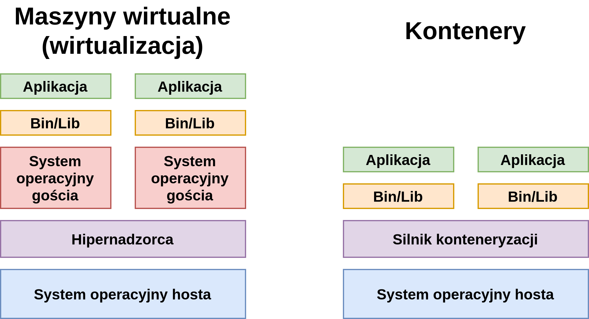

# Laboratorium 3
## Podstawy wykorzystania kontenerów - Docker, containerd

Podczas rozwoju jak i wdrażania aplikacji zalecane jest używanie reprodukowalnych i odizolowanych środowisk. Do tego celu można użyć **kontenerów**. Jednym z najpopularniejszych narzędzi do tworzenia i zarządzania kontenerami jest Docker. Mieliście z nim już do czynienia podczas zajęć z *Przetwarzania danych i odkrywania wiedzy* – [laboratorium L6](https://pwr-ai.github.io/przetwarzanie-danych-i-odkrywanie-wiedzy/laboratoria/lab6-produktyzacja.html). W ramach obecnego laboratorium przypomnimy sobie podstawy tego narzędzia, ponieważ będzie ono wykorzystywane do końca semestru.

# Kontenery a maszyny wirtualne

Środowiska uruchomieniowe dla aplikacji można tworzyć na wiele sposobów. Wiemy, że można używać do tego celu kontenerów, ale równie popularnym podejściem, było do niedawna, użycie maszyn wirtualnych. Który ze sposobów powinniśmy wybrać? Jakie są zalety i wady tych podejść?

1) **Maszyny wirtualne**

W systemie operacyjnym hosta uruchomiony jest hipernadzorca, który jest odpowiedzialny za wirtualizację, czyli m.in. tłumaczenie instrukcji maszynowych maszyn wirtualnych na polecenia dla systemu hosta, a zatem i dla procesora, przetłumaczanie wywołań systemowych (ang. *system calls*) oraz alokację zasobów. Następnym poziomem są systemy operacyjne gościa, które są uruchomione w ramach hipernadzorcy. Systemy gościa dostarczają potrzebnych bibliotek i plików uruchomieniowych (*Bin/Lib*) dla uruchomionych aplikacji.

2) **Kontenery**

Zamiast hipernadzorcy występuje tutaj silnik kontenerezacji, który wykorzystuje odpowiednie mechanizmy systemu operacyjnego hosta (więcej o tym poniżej), aby bezpośrednio uruchamiać aplikacje i dostarczać im potrzebnych bibliotek i plików uruchomieniowych. 

Wizualne porównanie tych podejść znajduje się na poniższym obrazku:



Jak widać maszyny wirtualne dostarczają większej izolacji od systemu operacyjnego hosta. Wiąże się to jednak z większym kosztem i zazwyczaj wolniejszym środowiskiem – głównie ze względu na potrzebę tłumaczenia instrukcji maszynowych i wywołań systemowych. Kontenery są narzędziem o mniejszym stopniu skomplikowania, pozwalającymi szybciej uruchamiać aplikacje i wymagają mniej zasobów (np. poprzez brak potrzeby uruchamiania systemu operacyjnego gościa).

# Kontenery w systemie Linux

W systemach z rodziny Linux/Unix idea kontenerów pojawiła się już na początku lat 2000. W systemie FreeBSD wprowadzono wtedy odizolowane środowiska o nazwie FreeBSD Jails. Inną implementacją było VServer project. Obecnie podwaliną konteneryzacji są tzw. grupy kontrolne (ang. *control groups* - w skrócie *cgroups*), które pozwalają zarządzać różnymi zasobami w systemie – np. jedna z cgroup jest odpowiedzialna za przydzielanie zasobów procesora, inna za ograniczanie dostępnej dla procesu pamięci operacyjnej RAM, jeszcze inna pozwala ograniczać dostęp do urządzeń wejścia/wyjścia, itd. Dodatkowym mechanizmem w systemie Linux są tzw. przestrzenie nazw (ang. *namespaces*), które pozwalają odizolować aplikacje od siebie. Z wykorzystaniem cgroup oraz namespaców można zaimplementować własny mini-silnik konteneryzacji – np. [1](https://www.infoq.com/articles/build-a-container-golang/), [2](https://github.com/p8952/bocker).

W 2008 roku Docker wykorzystał te mechanizmy i dołączył kilka warstw abstrakcji, pozwalając wprowadzić takie mechanizmy jak: wielowarstwowe obrazy kontenerów, usługa zarządzania kontenerami działająca w tle (ang. *daemon*) czy serwer rejestru obrazów.

# Docker compose
W przypadku aplikacji składających się z wielu modułów, każdy z nich warto umieścić w osobnym kontenerze. W celu ułtawienia korzystania i zarządzania takimi zespołami kontenerów powstało narzędzie Docker-compose. Pozwala m.in. na opisanie w pliku YAML konfiguracji każdej usługi (kontenera), określenie zależności między kontenerami czy przydziału zasobów. Z tym narzędziem mieliście również okazję się podstawowo zapoznać podczas zajęć z *Przetwarzania danych i odkrywania wiedzy*.

# Zadanie 1 (4 pkt)
Napisz swój własny obraz Dockerowy (tzn. `Dockerfile`). Po uruchomieniu kontenera powinien on wypisać wiadomość powitalną z wybraną grafiką w formacie ASCII (tzw. ASCII baner). Użyj następujących słów kluczowych w swoim pliku Dockerfile:
- FROM
- RUN
- ADD
- ENV
- ARG
- ENTRYPOINT
- CMD

# Zadanie 2 (1 pkt)
Odpowiedz na pytania:
1) Jaka jest różnica między `ENTRYPOINT` a `CMD`? 

2) Jak każdą z powyższych opcji nadpisać podczas uruchamiania kontenera? 

3) Jaka jest różnica między `ADD` a `COPY`?

4) Czy tylko jedno słowo kluczowe `FROM` może występować w pojedynczym pliku Dockerfile?

# Zadanie 3 (1 pkt)
Napisz skrypt `publish.sh`, który zbuduje obraz opisany przez podany Dockerfile (argument skryptu), a następnie prześle go i opublikuje na platformie [Docker Hub](https://hub.docker.com/)

```bash
$ ./publish.sh </path/to/Dockerfile>
```

# Zadanie 4 (4 pkt)
Napisz manifest (plik konfiguracyjny) dla narzędzia docker-compose. Uruchomione powinny być 3 usługi (kontenery), które się między sobą komunikują:
- `content` - kontener pozwalający wystawić jakąś treść (np. NGINX wystawiający prostą stronę WWW),
- `load-balancer` - kontener umożliwiający rozłożenie ruchu (tzw. *load-balancing*) między kontenery z treścią (np. NGINX w trybie load-balancera, który przekierowuje ruch na kontener `content`, potencjalnie wraz z jego kopiami)
- `checker` - kontener sprawdzający cyklicznie dostępność wystawianej treści (np. cURL uruchamiany co 5 sekund)

W pliku `docker-compose.yml` opisz usługi zgodnie z aktualną składnią Compose. Skonfiguruj politykę ponownego uruchamiania przez `restart` oraz komunikację między usługami przez sieć Compose (bez konieczności używania przestarzałego `links`).


Uruchom stos usług za pomocą komendy:

```bash
$ docker compose up
```
